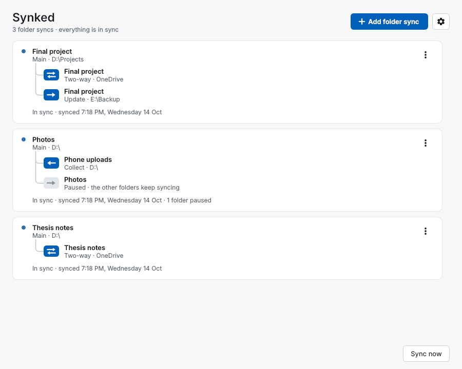
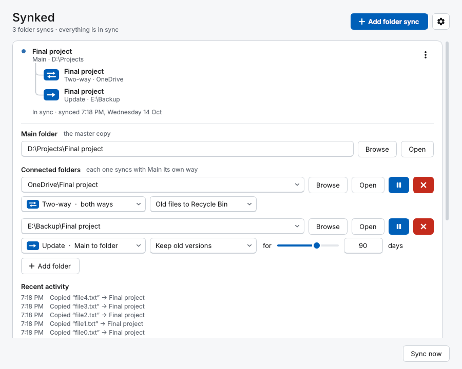

# Synked

**Keeps your folders in sync, continuously.** A small, free Windows app: pick a Main folder and
any number of connected folders (another drive, a USB disk, a folder inside OneDrive) and Synked
keeps them identical in the background, the moment anything changes.

*Synked by EAGER - Softech · An engineering by Er. K.K.*

<picture>
  <source media="(prefers-color-scheme: dark)" srcset="docs/screenshots/list-dark.png">
  
</picture>

## What it does

- **Continuous sync.** Changes are copied within seconds, while you work. No schedules, no
  "Sync" button to remember.
- **One Main folder, many connected folders**, each with its own way of syncing:

  | Type | Direction | What it does |
  |---|---|---|
  | **Two-way** | Main ⇄ folder | Changes flow both ways; if both sides changed, the newer one wins |
  | **Mirror** | Main → folder | The folder becomes an exact copy of Main |
  | **Update** | Main → folder | New and changed files are copied; nothing is ever deleted (good for backups) |
  | **Collect** | folder → Main | New and changed files are gathered into Main; nothing is ever deleted |

- **Nothing is lost.** Deleted or replaced files go to the **Recycle Bin**, or into a hidden
  `.synked-versions` folder, one dated folder per sync, kept for as many days as you choose (or forever).
- **Renames are mirrored** without re-copying. Copies are written to a temporary file and swapped
  in at the end, so a crash or power cut never leaves a half-written file.
- **Unplugged drives don't stop anything.** The other folders keep syncing; the missing one
  catches up by itself when it's back.
- **Pause a single folder** while the rest keep going.
- Drag and drop folders, live progress, light / dark / auto theme, tray icon, Start with
  Windows, and **export / import** of all your syncs as a `.kiru` file.

<picture>
  <source media="(prefers-color-scheme: dark)" srcset="docs/screenshots/editor-dark.png">
  
</picture>

## Download

Get **`Synked.exe`** from the [latest release](https://github.com/kirupakaran-k/synked/releases/latest)
and run it. Nothing to install. Windows 10 or 11.

The app isn't code-signed, so the first time Windows SmartScreen may say *"Windows protected
your PC"*: click **More info → Run anyway**.

## Build it yourself

1. Install Python 3.10 or newer: `winget install Python.Python.3.12`
2. Double-click **`build.bat`**. It sets up the build tools (Qt is about 100 MB the first time),
   shows its progress, and puts `Synked.exe` in a `build <version>` folder next to this one.

Or run it straight from source: `py -m pip install -r requirements.txt`, then `py app.py`.
Tests: `py -m pip install pytest`, then `py -m pytest tests`.

The full user guide (sync types, old versions, what happens when, where settings are kept) is in
[docs/USER-GUIDE.md](docs/USER-GUIDE.md).

## Version history

Every version is kept here as its own commit and tag, from the very first build. Pick one under
[Releases](https://github.com/kirupakaran-k/synked/releases) or [Tags](https://github.com/kirupakaran-k/synked/tags)
to see or download exactly that version's code. What changed each time is in
[CHANGELOG.md](CHANGELOG.md). Up to 3.2 the app was called **SyncMate**.

| | Highlights |
|---|---|
| **3.x** | Qt window with smooth animations; unplugged drives don't stop a sync; pause single folders; renamed to Synked |
| **2.x** | Multi-folder syncs and sync types; export / import (`.kiru`); dated old-version folders; hover hints |
| **1.x** | First two-way folder-pair sync; themes; settings; drag and drop; live progress |

## How it's made

Python, with [PySide6 / Qt](https://doc.qt.io/qtforpython-6/) for the window,
[watchdog](https://github.com/gorakhargosh/watchdog) to notice changes,
[Send2Trash](https://github.com/arsenetar/send2trash) for the Recycle Bin and
[Pillow](https://python-pillow.org/) to draw the icon. The sync engine compares each side
with a small SQLite record of how things looked after the last sync, so it can tell an edit
from a delete and which side changed.

| File | Purpose |
|---|---|
| `app.py` | Window, tray icon, settings menu, activity log, export / import, Start with Windows |
| `cards.py` | The folder-sync cards: folder tree, status, live progress, the editor that slides open |
| `controls.py` | Toggle switch, theme picker, wrapping rows, tree lines, folder boxes that take drops |
| `theme.py` | Light and dark colours, the style sheet, and the icons (drawn in code) |
| `watcher.py` | Watches every folder, batches changes, runs syncs in the background |
| `engine.py` | The sync rules for each sync type, and version keeping |
| `store.py` | Jobs, settings and sync history |
| `icon.py`, `exe_info.py`, `version.py` | The app icon, the exe's details, the name and version |
| `tests/` | Automated tests of syncing and of the window |

## Licence

Synked is free software under the **GNU General Public License v3.0** ([LICENSE](LICENSE)):
you may use, study, share and change it; versions you share must stay under the GPL with their
source.

It uses PySide6 (LGPL-3.0), watchdog (Apache-2.0), Send2Trash (BSD-3-Clause) and Pillow
(MIT-CMU), each under its own licence. The settings gear is drawn from Google's
[Material Icons](https://fonts.google.com/icons) (Apache-2.0).

© EAGER - Softech · An engineering by Er. K.K.
